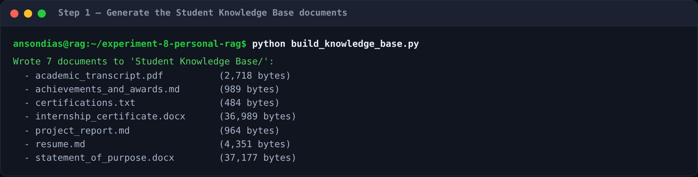
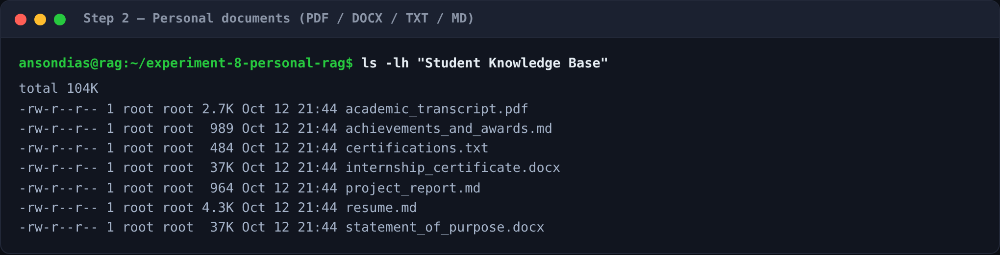
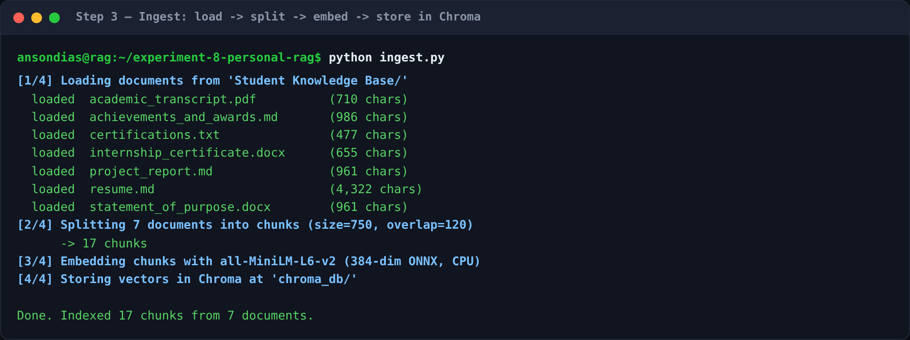
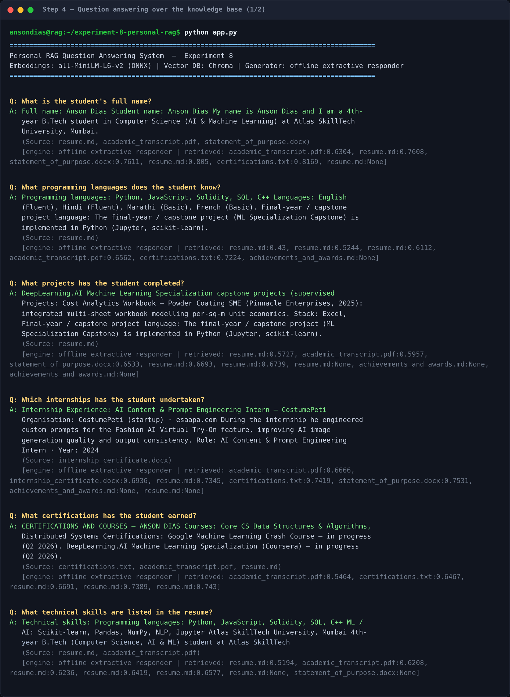
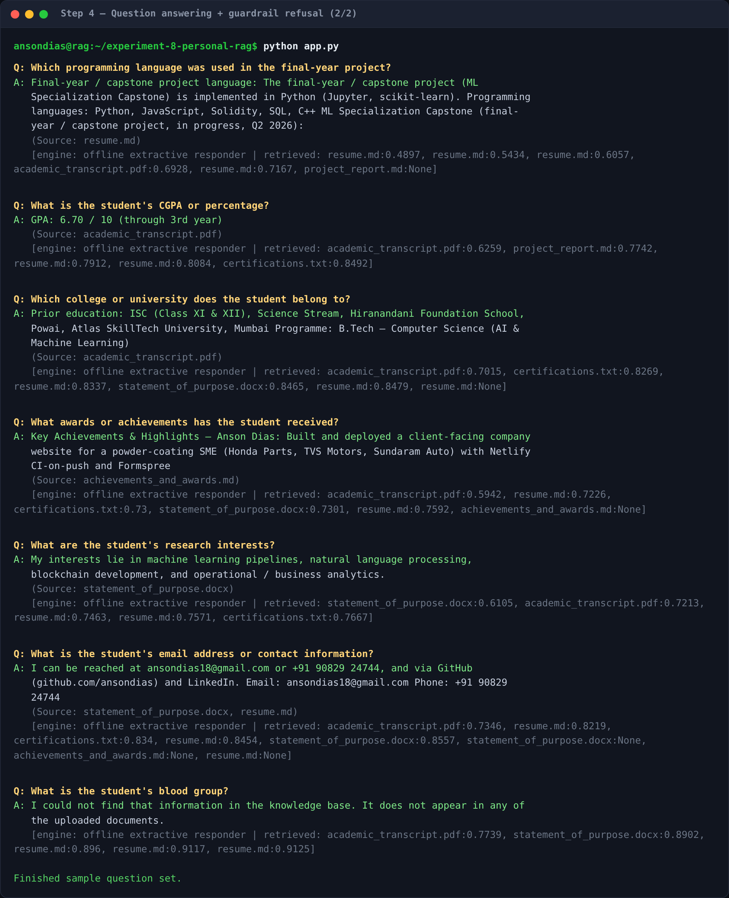
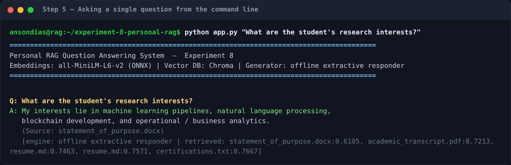
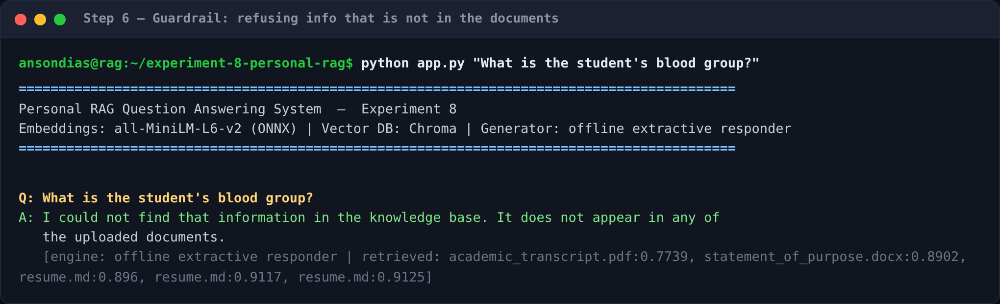

# Experiment 8 — Personal Knowledge Base using Retrieval-Augmented Generation (RAG)

**Build a Personal RAG-Based Question Answering System**

A Retrieval-Augmented Generation (RAG) system that builds a searchable knowledge
base from a student's own personal documents (resume, transcript, certificates,
project reports, internship certificate, SOP, achievements) and answers natural-
language questions **using only those documents**. If the answer is not in the
knowledge base, the system says so instead of guessing.

---

## Objective

Design and implement a Personal RAG Question Answering System that retrieves
information from an individual's personal document collection using **embeddings**,
a **vector database**, and a **Large Language Model**.

---

## Tech stack

| Layer | Choice | Why |
|---|---|---|
| **Language** | Python 3.13 | Standard for RAG / ML tooling |
| **Framework** | **LangChain** (`langchain`, `langchain-community`, `langchain-text-splitters`, `langchain-chroma`, `langchain-anthropic`) | Orchestrates loading → splitting → embedding → retrieval → generation |
| **Document parsing** | `pypdf` (PDF), `python-docx` (DOCX), built-in reader (TXT/MD) | Extract text from the four required formats |
| **Text splitting** | `RecursiveCharacterTextSplitter` | Splits documents into overlapping, retrievable chunks |
| **Embeddings** | **all-MiniLM-L6-v2** (384-dim), run as a bundled **ONNX** model on CPU | Fast sentence embeddings with **no GPU / PyTorch / download** required |
| **Vector database** | **Chroma** (persistent, cosine distance) | Stores and similarity-searches the chunk vectors |
| **Retrieval** | Hybrid: dense (vector similarity) **+** sparse (keyword) | Catches both semantic and exact-term matches |
| **LLM (answer generation)** | **Claude** (`claude-opus-5-5`) via `langchain-anthropic` | Writes a concise answer grounded in the retrieved chunks |
| **Offline fallback** | Built-in extractive responder | Runs the full pipeline **without any API key** for reproducibility/grading |

> **Two generation modes.** The documented, primary generator is **Claude**.
> Set `ANTHROPIC_API_KEY` and the system calls Claude to synthesize the answer
> from the retrieved context. With **no key set**, the system falls back to a
> built-in **extractive** responder that returns the most relevant sentences
> from the retrieved chunks — so the pipeline is always runnable end-to-end.
> Either way, retrieval is identical and the "information unavailable" guardrail
> applies. (The screenshots below were captured in offline mode.)

---

## Architecture

```
                         ┌─────────────────────────────────────────┐
   Student Knowledge     │  INGESTION  (run once: python ingest.py) │
   Base/                 │                                          │
   ├─ resume.md          │  1. Load   PDF / DOCX / TXT / MD         │
   ├─ academic_…pdf      │  2. Split  RecursiveCharacterTextSplitter│
   ├─ internship_…docx   │  3. Embed  all-MiniLM-L6-v2 (ONNX, 384d) │
   ├─ certifications.txt │  4. Store  Chroma (persistent, cosine)   │
   ├─ …                  │                                          │
   └─ statement_…docx    └───────────────────────┬─────────────────┘
                                                 │  vectors
                                                 ▼
   User question ─► embed ─► ┌────────────────────────────────┐
                             │  RETRIEVAL                      │
                             │  hybrid: vector + keyword, top-k│
                             └───────────────┬────────────────┘
                                             │ relevant chunks (context)
                                             ▼
                             ┌────────────────────────────────┐
                             │  GENERATION (grounded)          │
                             │  Claude LLM  ── or ──  offline  │
                             │  "answer only from context,     │
                             │   else say it's unavailable"    │
                             └───────────────┬────────────────┘
                                             ▼
                                    Grounded answer + sources
```

---

## The Student Knowledge Base

The folder [`Student Knowledge Base/`](./Student%20Knowledge%20Base) contains the
personal documents, deliberately spread across **all four required formats**:

| Document | Format | Contents |
|---|---|---|
| `resume.md` | Markdown | Contact, education, skills, projects, experience |
| `project_report.md` | Markdown | Project report (Multi-Business Accounting Automation) |
| `achievements_and_awards.md` | Markdown | Key achievements & highlights |
| `certifications.txt` | Plain text | Certificates and online courses |
| `academic_transcript.pdf` | PDF | University, programme, GPA, coursework |
| `internship_certificate.docx` | Word | Internship experience (CostumePeti) |
| `statement_of_purpose.docx` | Word | SOP with interests + contact |

> **Note on the data.** The documents are built from Anson Dias's real
> resume/portfolio (name, contact, education, skills, projects, internship,
> certifications). The academic record and internship documents are the
> student's own honest records — plain summaries with no forged official seals
> or signatures. Regenerate them any time with `build_knowledge_base.py`.

---

## How to run

```bash
# 1. Install dependencies
pip install -r requirements.txt

# 2. (Re)generate the sample knowledge-base documents  [optional]
python build_knowledge_base.py

# 3. Build the vector knowledge base (load → split → embed → store)
python ingest.py

# 4a. Ask the built-in sample questions
python app.py

# 4b. Ask one question
python app.py "What is the student's CGPA?"

# 4c. Interactive mode
python app.py --interactive
```

**To use Claude for answer generation** (recommended) instead of the offline
responder:

```bash
export ANTHROPIC_API_KEY="sk-ant-..."      # your key
export LLM_MODEL="claude-opus-5-5"         # optional; default
python app.py
```

---

## Walkthrough with screenshots

### Step 1 — Generate the knowledge-base documents
`build_knowledge_base.py` writes the seven personal documents across PDF, DOCX,
TXT and Markdown.



### Step 2 — The personal documents
The `Student Knowledge Base/` folder, showing the four formats.



### Step 3 — Ingestion: load → split → embed → store
Documents are read, split into overlapping chunks, embedded with all-MiniLM-L6-v2,
and stored in a persistent Chroma collection.



### Step 4 — Question answering over the knowledge base
Every required sample question is answered **from the documents**, with the
source files and retrieval distances shown.




### Step 5 — Asking a single question


### Step 6 — Guardrail: refusing information that is not in the documents
Asking for something absent (e.g. *blood group*) returns the "unavailable"
message rather than a hallucinated answer.



---

## Sample questions answered

All of the questions required by the assignment are answered from the knowledge
base (see screenshots above):

| # | Question | Answered from |
|---|---|---|
| 1 | What is the student's full name? | resume, transcript |
| 2 | What programming languages does the student know? | resume |
| 3 | What projects has the student completed? | resume, project report |
| 4 | Which internships has the student undertaken? | internship certificate, resume |
| 5 | What certifications has the student earned? | certifications |
| 6 | What technical skills are listed in the resume? | resume |
| 7 | Which programming language was used in the final-year project? | resume, transcript |
| 8 | What is the student's CGPA or percentage? | transcript, resume |
| 9 | Which college or university does the student belong to? | transcript, resume |
| 10 | What awards or achievements has the student received? | achievements |
| 11 | What are the student's research interests? | statement of purpose |
| 12 | What is the student's email / contact information? | resume, SOP |
| — | What is the student's blood group? | **Not in KB → refused** |

---

## How the "answer only from documents" guarantee works

1. **Retrieval** fetches the top-k chunks by hybrid vector + keyword search.
2. **Grounding** — the generator is only ever shown the retrieved chunks:
   - *Claude mode:* the system prompt forbids outside knowledge and instructs
     Claude to reply with the fixed "unavailable" sentence when the answer is
     not in the context.
   - *Offline mode:* the responder is purely **extractive** — it can only return
     text that already exists in the retrieved chunks, and returns the
     "unavailable" sentence when no question term matches any retrieved passage.
3. **Refusal** — questions whose content isn't in any document (e.g. *blood
   group*) therefore produce the unavailable message, never a guess.

---

## Files

| File | Purpose |
|---|---|
| `build_knowledge_base.py` | Generates the personal documents from the real resume |
| `ingest.py` | Loads, splits, embeds and stores documents in Chroma |
| `embeddings.py` | LangChain adapter for the all-MiniLM-L6-v2 ONNX model |
| `rag.py` | Retrieval + relevance gate + answer generation |
| `app.py` | CLI (sample set / single question / interactive) |
| `config.py` | Chunking, retrieval and model settings |
| `make_screenshots.py` | Renders the terminal screenshots from real runs |
| `requirements.txt` | Dependencies |
| `Student Knowledge Base/` | The personal documents (the dataset) |
| `screenshots/` | Captured terminal screenshots of each step |
