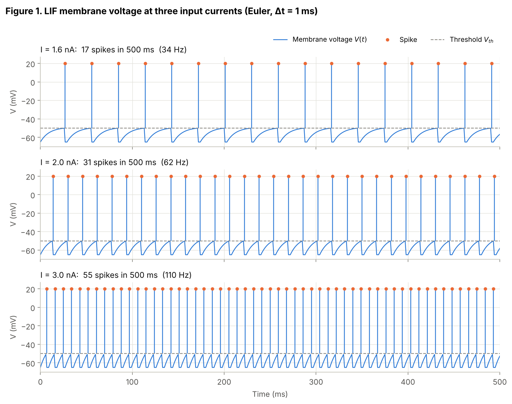
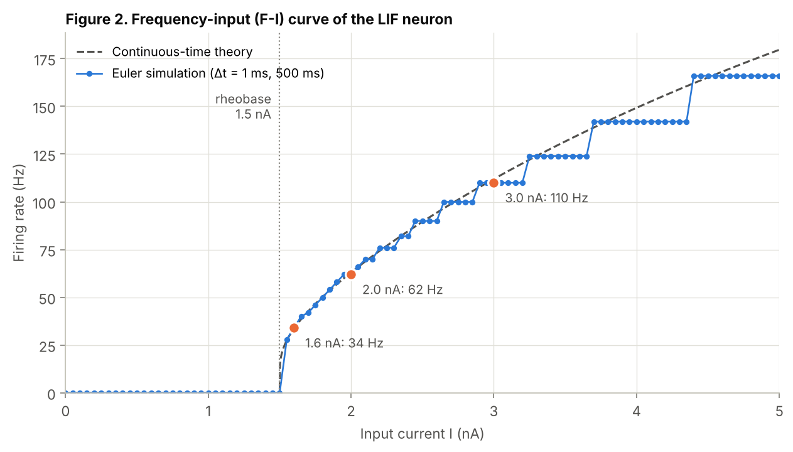
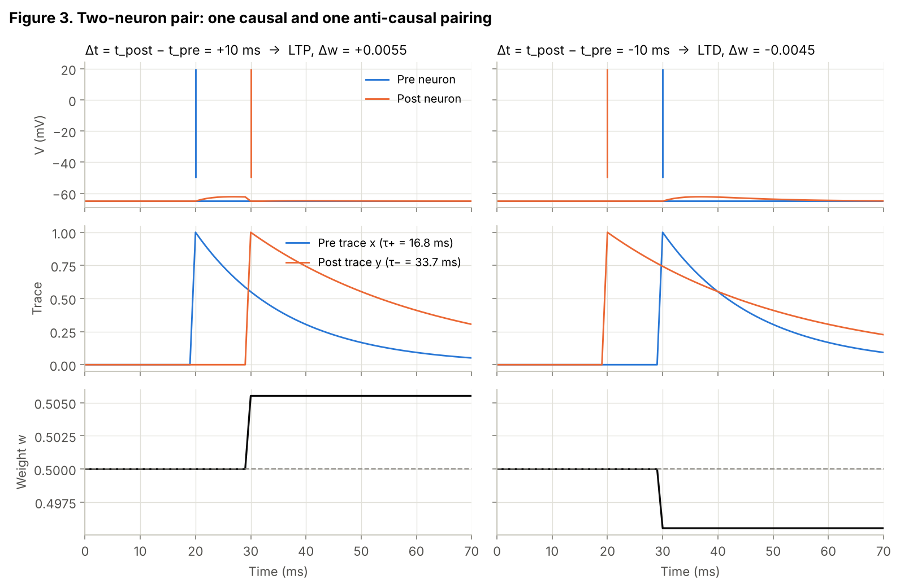
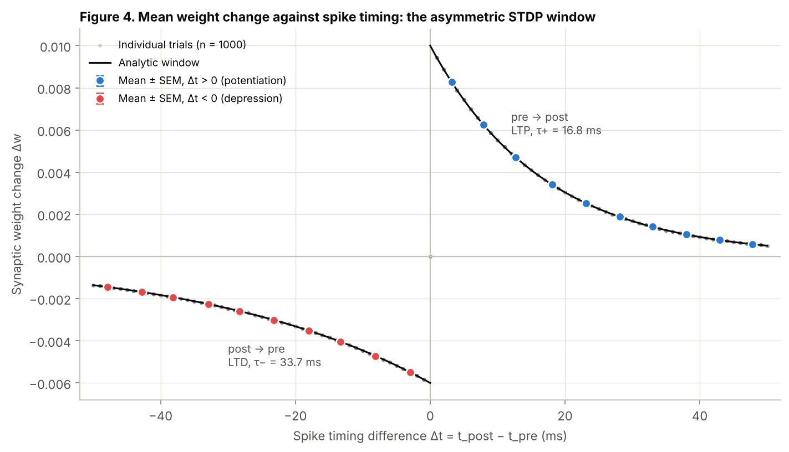

# Lab 6: Leaky Integrate-and-Fire Neuron and STDP

A leaky integrate-and-fire (LIF) neuron integrated with forward Euler (Δt = 1 ms), its
frequency-input curve, and a two-neuron pair with an asymmetric exponential STDP rule,
checked against the analytic window over 1000 random-timing trials.

| File | What it is |
|---|---|
| `lab6_lif_stdp.ipynb` | The submission notebook: code, outputs, figures and written answers (already executed) |
| `lab6_lif_stdp.pdf` | The same notebook exported to PDF |
| `lab6_lif_stdp.py` | The same code as a plain script (jupytext percent format) |
| `figures/` | The four figures as PNGs |

## Run it

```bash
pip install -r requirements.txt
jupyter nbconvert --to notebook --execute --inplace lab6_lif_stdp.ipynb   # or open it in Jupyter / Colab
python lab6_lif_stdp.py                                                 # plain-script version
```

The whole notebook runs in a few seconds. The STDP trials use a fixed seed, so the numbers
are reproducible.

## Results

**Part 1: LIF voltage traces.** τ_m = 10 ms, E_L = −65 mV, V_th = −50 mV, V_reset = −65 mV,
R_m = 10 MΩ, t_ref = 2 ms.

| I (nA) | Spikes in 500 ms | Rate (Hz) | ISI (ms) |
|---|---|---|---|
| 1.6 | 17 | 34 | 29 |
| 2.0 | 31 | 62 | 16 |
| 3.0 | 55 | 110 | 9 |



**Part 2: F-I curve.** The neuron is silent up to the 1.5 nA rheobase, then the rate rises
steeply and sublinearly. The simulated spike counts match the closed-form solution of the
Euler map at all 101 currents.



**Part 3: STDP.** Δw = +A₊ e^(−Δt/τ₊) for Δt > 0 and −A₋ e^(Δt/τ₋) for Δt < 0, with
A₊ = 0.010, τ₊ = 16.8 ms, A₋ = 0.006 and τ₋ = 33.7 ms (Bi & Poo). The rule is implemented
online with pre and post eligibility traces on two LIF neurons. In all 1000 trials,
pre-before-post pairings potentiate and post-before-pre pairings depress. A log-linear fit
recovers τ₊ = 16.80 ms and τ₋ = 33.70 ms, and every trial matches the analytic window to
within 1e-16.



